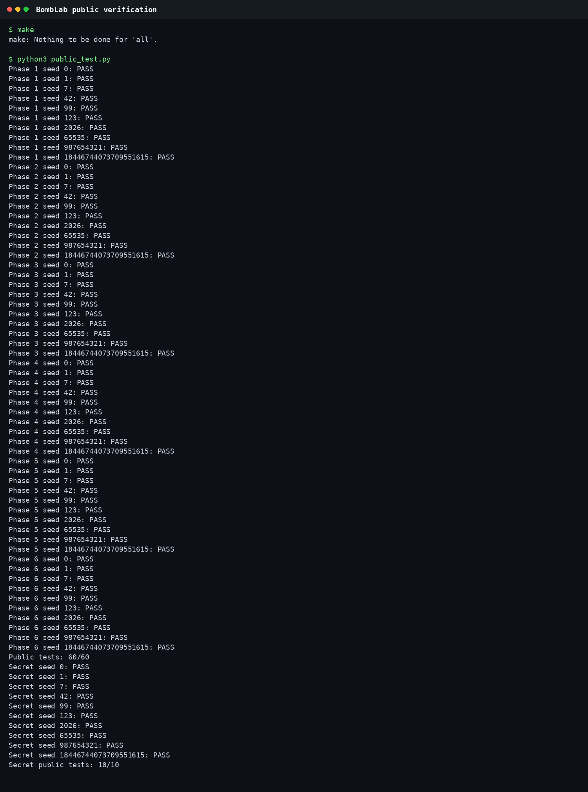
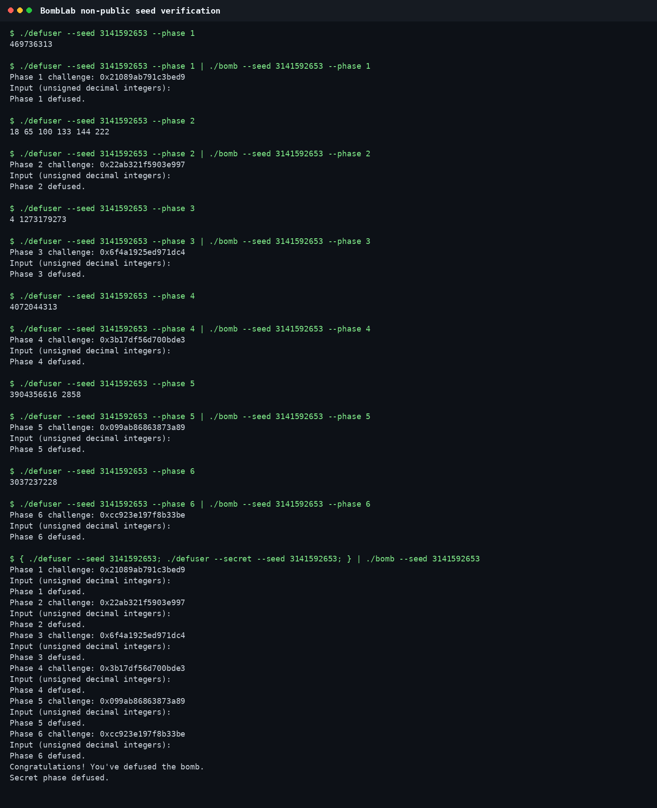

# Lab 2: BombLab

## 1. 实验基本信息

- 实验名称：Lab 2: BombLab
- 实验目标：分析个人 `bomb` 的 x86-64 汇编，在 `defuser.c` 中恢复由 `challenge` 计算各关口令的通用关系，并完成六个常规关卡与 Honor。
- 代码修改：`defuser.c`

## 2. 实验环境与工具

- 操作系统：Ubuntu 24.04，Linux 6.17.0-35-generic，x86-64
- GCC：13.3.0
- GDB：15.1
- GNU objdump / Binutils：2.42
- Python：3.12.3
- 主要工具：`objdump`、`gdb`、`nm`、`readelf`、`make`、`public_test.py`

主要分析命令如下：

```bash
nm -n ./bomb
objdump -d -M intel --disassemble=phase_01 ./bomb
objdump -d -M intel --disassemble=p1_compute ./bomb
gdb -q -batch ./bomb -ex 'x/8gx 0x405820'
make
python3 public_test.py
```

所有计算均使用 `uint32_t` 表达 32 位寄存器的模 `2^32` 回绕行为，避免有符号溢出带来的未定义行为。二进制 `.rodata` 中存在看似指令的英文字符串和错误公式，但它们没有进入实际执行控制流，因此分析只依据反汇编指令、跳转目标和实际测试。

## 3. 第 1 关：函数调用与返回值

### 3.1 关键汇编

`phase_01` 只接受一个 `uint32_t`，随后调用 `p1_compute(challenge)` 并比较结果：

```asm
mov    r12,rsi
...
mov    rdi,r12
call   p1_compute
cmp    DWORD PTR [rbp-0x14],eax
sete   al
```

三个计算函数的关键指令为：

```asm
; p1_step0
sub    edi,esi
lea    eax,[rdi+rdi*2+0x4b6f]

; p1_step1
lea    eax,[rsi+0x9e38]
xor    eax,edi

; p1_step2
lea    eax,[rdi+rsi*8]
xor    eax,0x80b8
```

`p1_compute` 末尾保存 `step0` 到 `ecx`，完成 `step2` 后执行 `xor eax,ecx`。

### 3.2 计算关系

定义：

```c
low    = (uint32_t)challenge;
high   = (uint32_t)(challenge >> 32);
middle = (uint32_t)(challenge >> 16);
```

则：

```c
step0 = 3u * (low - high) + 0x4b6f;
step1 = (middle + 0x9e38) ^ high;
step2 = (step1 + 8u * low) ^ 0x80b8;
answer = step2 ^ step0;
```

`lea eax,[rdi+rsi*8]` 使用 x86 的 `base + index * scale` 寻址形式，但这里只做算术而不访问内存，因此比例因子为 8。

### 3.3 验证

非公开列表 seed `3141592653`：

```text
challenge = 0x21089ab791c3bed9
answer    = 469736313
Phase 1 defused.
```

## 4. 第 2 关：数组、循环与递推

### 4.1 关键汇编

`phase_02` 要求六个整数。第一个整数单独检查，随后循环检查余下五个：

```asm
shr    rax,0x17
and    eax,0x1f
cmp    esi,eax
...
mov    ecx,0xa
mov    edi,0xd
shr    rax,cl
and    eax,0x3f
add    eax,esi
xor    eax,edi
...
add    ecx,0x1
add    edi,0xd
cmp    ecx,0xf
jne    ...
```

### 4.2 递推关系

```c
values[0] = (challenge >> 23) & 0x1f;
for (uint32_t i = 1; i < 6; ++i) {
    uint32_t part = (challenge >> (9 + i)) & 0x3f;
    values[i] = (values[i - 1] + part) ^ (13 * i);
}
```

循环第一次的移位量是 10、异或常量是 13；每轮分别递增 1 和 13，所以最后一轮使用移位 14 与常量 65。

### 4.3 验证

```text
challenge = 0x22ab321f5903e997
answer    = 18 65 100 133 144 222
Phase 2 defused.
```

## 5. 第 3 关：switch 与跳转表

### 5.1 参数和跳转表

```asm
and    edi,0x7
cmp    DWORD PTR [rbp-0x18],edi
...
shr    rax,0x3
shr    rsi,0x20
xor    esi,eax
call   p3_dispatch
```

因此第一个输出是：

```c
selector = (uint32_t)challenge & 7;
```

传给分支函数的参数是：

```c
x = (uint32_t)(challenge >> 3) ^ (uint32_t)(challenge >> 32);
```

`p3_dispatch` 使用 `jmp QWORD PTR [rax*8+0x405820]`。用 GDB 查看八个指针后，选择器到实际 case 的顺序为：

```text
selector: 0 1 2 3 4 5 6 7
case:     7 3 2 1 0 5 6 4
```

### 5.2 各分支关系

| selector | 结果 |
|---:|---|
| 0 | `3*x + 0xb15b` |
| 1 | `(x ^ 0x4863) + (x >> 1)` |
| 2 | `5*x + 0x2d1a4` |
| 3 | `3*x + 0x7e41` |
| 4 | `(4*x) ^ 0xc6fd` |
| 5 | `5*x + 0xbfd1` |
| 6 | `(4*x) ^ 0xc88e` |
| 7 | `(x ^ 0xbd18) + (x >> 1)` |

输出为 `selector result` 两个整数。

### 5.3 验证

```text
challenge = 0x6f4a1925ed971dc4
answer    = 4 1273179273
Phase 3 defused.
```

## 6. 第 4 关：递归二分遍历

### 6.1 初始参数

`phase_04` 调用：

```c
target = (uint32_t)challenge & 0x7f;
key = (uint32_t)(challenge >> 7) ^ (uint32_t)(challenge >> 32);
p4_walk(target, 0, 0x7f, key);
```

关键汇编：

```asm
sub    edi,esi
shr    edi,1
add    edi,esi              ; middle = low + (high-low)/2
cmp    edi,eax
je     base
...
call   p4_walk
lea    eax,[rax+rax*4]      ; 5 * child
xor    eax,ebx
xor    eax,0x7              ; 右分支
...
xor    eax,0x9              ; 左分支
```

### 6.2 恢复出的递归关系

令 `middle = low + ((high - low) >> 1)`：

```text
target == middle:
    return (middle + 0xa9) ^ key

target < middle:
    child = walk(target, low, middle - 1, key)
    return (5 * child) ^ (middle + key) ^ 9

target > middle:
    child = walk(target, middle + 1, high, key)
    return (5 * child) ^ (middle + key) ^ 7
```

### 6.3 验证

```text
challenge = 0x3b17df56d700bde3
answer    = 4072044313
Phase 4 defused.
```

## 7. 第 5 关：结构体、指针与链表

### 7.1 结构体布局

`p5_traverse` 的访问方式为：

```asm
add eax,DWORD PTR [rdx]
mov esi,DWORD PTR [rdx+0x4]
mov rdx,QWORD PTR [rdx+0x8]
```

因此节点布局是：

```c
struct Node {
    uint32_t value;   // +0
    uint32_t tag;     // +4
    struct Node *next;// +8
};
```

从 `p5_heads` 和 `p5_nodes` 读取出的头节点下标为：

```text
{3, 4, 5, 1, 9, 0, 6, 7}
```

节点内容如下（`-` 表示空指针）：

| 下标 | value | tag | next |
|---:|---:|---:|---:|
| 0 | `0xa284` | `0x0780` | 6 |
| 1 | `0x972f` | `0x0462` | 9 |
| 2 | `0x4c26` | `0x017d` | - |
| 3 | `0x893b` | `0x0621` | 4 |
| 4 | `0x1554` | `0x0039` | 5 |
| 5 | `0x0194` | `0x0b2a` | 1 |
| 6 | `0xff42` | `0x0963` | 7 |
| 7 | `0x40a7` | `0x0886` | 10 |
| 8 | `0x95d6` | `0x0a3a` | 11 |
| 9 | `0x2c33` | `0x0533` | 0 |
| 10 | `0x6eee` | `0x0215` | 8 |
| 11 | `0x19f1` | `0x0354` | 2 |

### 7.2 遍历和折叠

```c
node = heads[(uint32_t)challenge & 7];
steps = (uint32_t)(challenge >> 3) & 3;
fold = (uint32_t)(challenge >> 6) ^ (uint32_t)(challenge >> 32);
fold = 3 * (fold ^ 0xc007) + node->value;
fold ^= node->tag;

repeat steps times:
    node = node->next;
    fold = 3 * fold + node->value;
    fold ^= node->tag;
```

最终输出 `fold` 和最后节点的 `tag`。这里第一个节点同样参与 `value` 与 `tag` 的折叠。

### 7.3 验证

```text
challenge = 0x099ab86863873a89
answer    = 3904356616 2858
Phase 5 defused.
```

## 8. 第 6 关：函数指针表与间接调用

### 8.1 两次函数指针调用

```asm
shr    rdi,0x6
shr    rax,0x20
xor    edi,eax
and    ebx,0x38
and    eax,0x7
call   QWORD PTR [rax*8+0x405e00]
xor    eax,0x23e
...
call   QWORD PTR [rbx+0x405e00]
add    eax,0xab1b
```

函数表下标到操作的映射为：

```text
index: 0   1   2   3   4   5   6   7
op:    op2 op5 op2 op0 op3 op4 op1 op5
```

各操作为：

```c
op0(x) = (8*x + 0x6928) ^ (5*x);
op1(x) = ((x >> 7) ^ x) + 0x59c1;
op2(x) = rol32(x, 2) ^ 0x2b5f;
op3(x) = (x + 0x62d1) ^ (x >> 2);
op4(x) = (x ^ 0xd927) + (x << 7);
op5(x) = ror32(x, 3);
```

### 8.2 完整关系

```c
low = (uint32_t)challenge;
argument = (uint32_t)(challenge >> 6) ^ (uint32_t)(challenge >> 32);
first = ops[low & 7](argument) ^ 0x23e;
answer = ops[(low >> 3) & 7](first) + 0xab1b;
```

### 8.3 验证

```text
challenge = 0xcc923e197f8b33be
answer    = 3037237228
Phase 6 defused.
```

## 9. Honor

### 9.1 `secret_gate` 的格式要求

`secret_gate` 先复制整行输入，然后检查本地缓冲区偏移 `0x20` 处的四字节：

```asm
cmp DWORD PTR [rbp-0xb0],0x4e45504f
```

小端序的 `0x4e45504f` 是字符串 `OPEN`。缓冲区从 `rbp-0xd0` 开始，因此 `OPEN` 必须恰好位于第 32～35 字节。随后 `secret_phase` 从第 36 字节开始解析三个无符号整数。

实现使用 32 个句点作为前缀：

```text
................................OPENa b c
```

### 9.2 三个整数的计算

定义：

```c
choice = (uint32_t)context & 3;
challenge_fold = (uint32_t)challenge ^ (uint32_t)(challenge >> 32);
context_fold = (uint32_t)context ^ (uint32_t)(context >> 32);
```

`secret_mix(x)` 的汇编为先计算 `7*x + 0x1eb2`，再异或 `0x9561`。三个字段为：

```c
first = choice;
mixed = (7 * (challenge_fold ^ context_fold) + 0x1eb2) ^ 0x9561;
second = mixed ^ (choice * 0x1eb2) ^ (uint32_t)(context >> 16);
third = second ^ (context_fold + choice + 0x9561 + (challenge_fold >> 7));
```

用 `snprintf` 写入并检查返回长度，防止超过 `cap`。

### 9.3 验证

对 seed `3141592653`，求解器生成的 Honor 行为：

```text
................................OPEN1 3043612364 901778119
```

把六关输出和该行一起送入 bomb 后得到：

```text
Congratulations! You've defused the bomb.
Secret phase defused.
```

## 10. 测试结果

### 10.1 公开测试

```text
Public tests: 60/60
Secret public tests: 10/10
```



### 10.2 非公开列表 seed

选择不在 `tests/public.json` 中的 seed `3141592653`，逐关测试均出现 `Phase X defused.`，整体验证也通过 Honor。



### 10.3 额外稳健性检查

使用固定随机源 `random.Random(20261016)` 生成额外 seed：

```text
Phase 1: 100 deterministic random seeds PASS
Phase 2: 100 deterministic random seeds PASS
Phase 3: 100 deterministic random seeds PASS
Phase 4: 100 deterministic random seeds PASS
Phase 5: 100 deterministic random seeds PASS
Phase 6: 100 deterministic random seeds PASS
Full run + Honor: 25 deterministic random seeds PASS
```

另外使用 `-Wall -Wextra -Wpedantic -Werror` 编译无警告，并用 AddressSanitizer 与 UndefinedBehaviorSanitizer 编译运行检查。

## 11. 实验总结

本实验的关键不是求某一个 seed 的固定口令，而是恢复 64 位 `challenge` 到若干 32 位结果的通用映射。分析过程中需要特别注意：

1. 写入 32 位寄存器会清零对应 64 位寄存器的高 32 位；
2. `lea` 可以用于纯算术计算；
3. 跳转表和函数指针表必须读取真实表项，不能假设符号排列就是调用顺序；
4. 链表节点的布局可由偏移 `0`、`4`、`8` 的访问恢复；
5. 无符号 32 位计算的自然回绕是算法的一部分；
6. `.rodata` 中未被控制流使用的文本不能代替汇编证据。

## 12. 资料与 AI 工具使用说明

参考资料：

- [课程 Lab2 实验文档](https://ics-26fall-fdu.github.io/labs/lab2-bomb-lab/)
- [课程 BombLab 模板仓库](https://github.com/ICS-26Fall-FDU/BombLab)
- GNU Binutils `objdump`、GDB 本地帮助与手册页
- System V AMD64 调用约定和 x86-64 指令语义

AI 使用情况：按照课程更新后的要求，本实验使用 OpenAI Codex 协助读取和解释反汇编、恢复计算关系、实现 `defuser.c`、设计多 seed 验证、运行测试并整理报告。所有结论均通过个人 `bomb` 的实际执行、公开测试及额外随机 seed 验证；报告中的命令、输出与图片均来自本仓库的真实运行结果。
